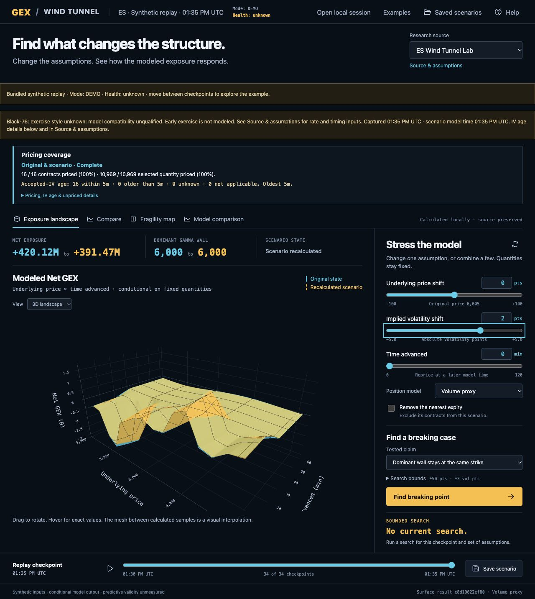
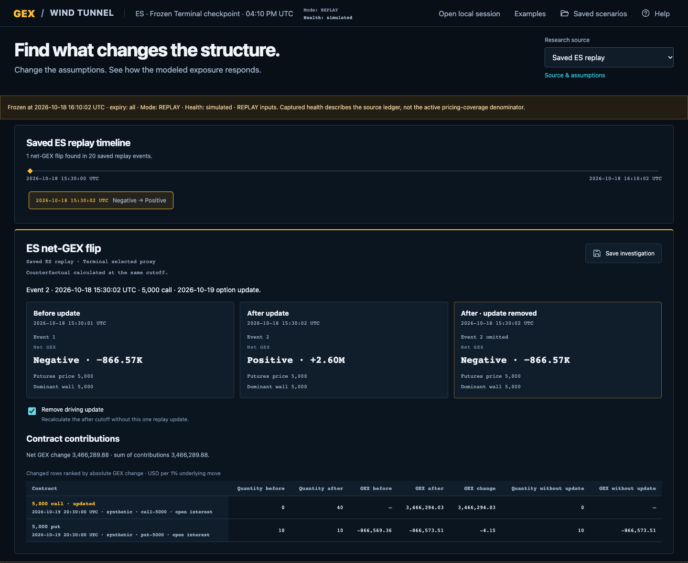
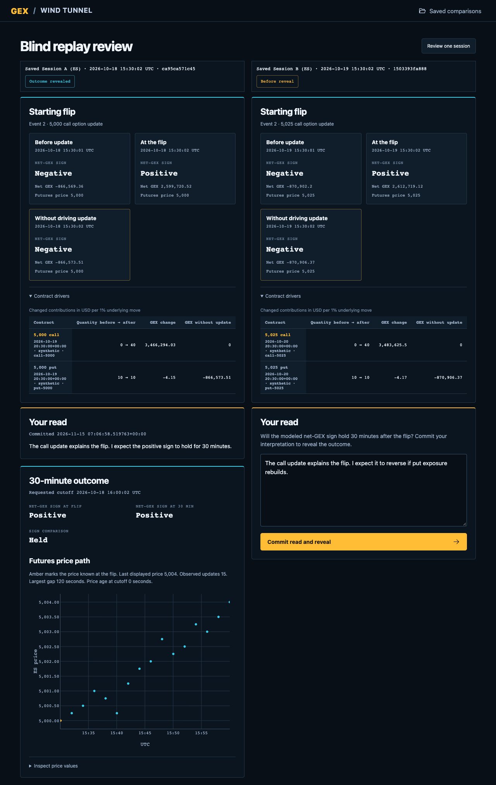
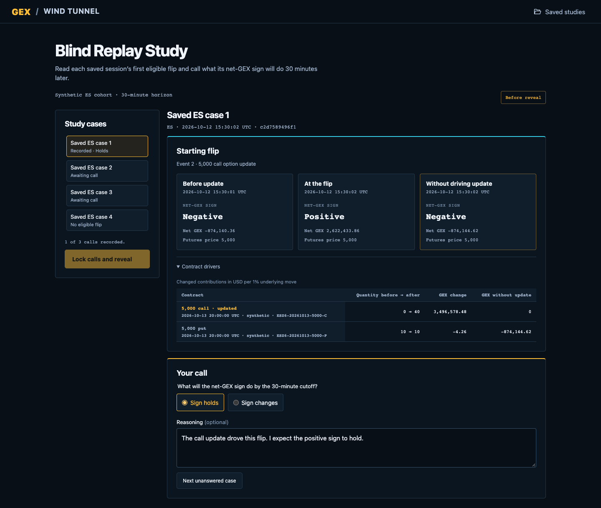
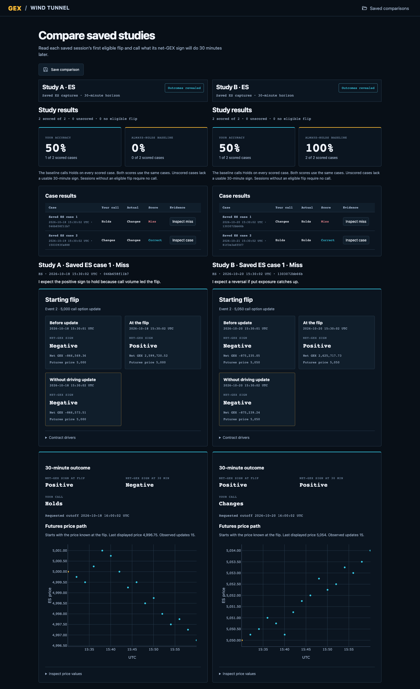
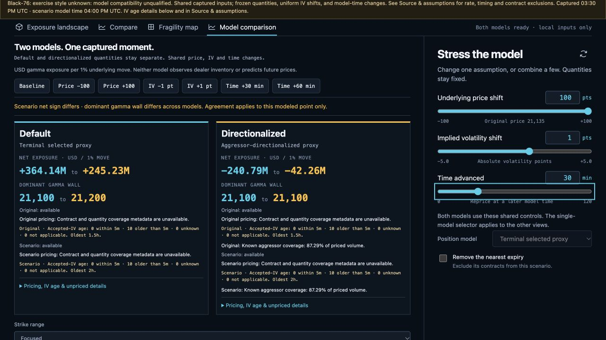
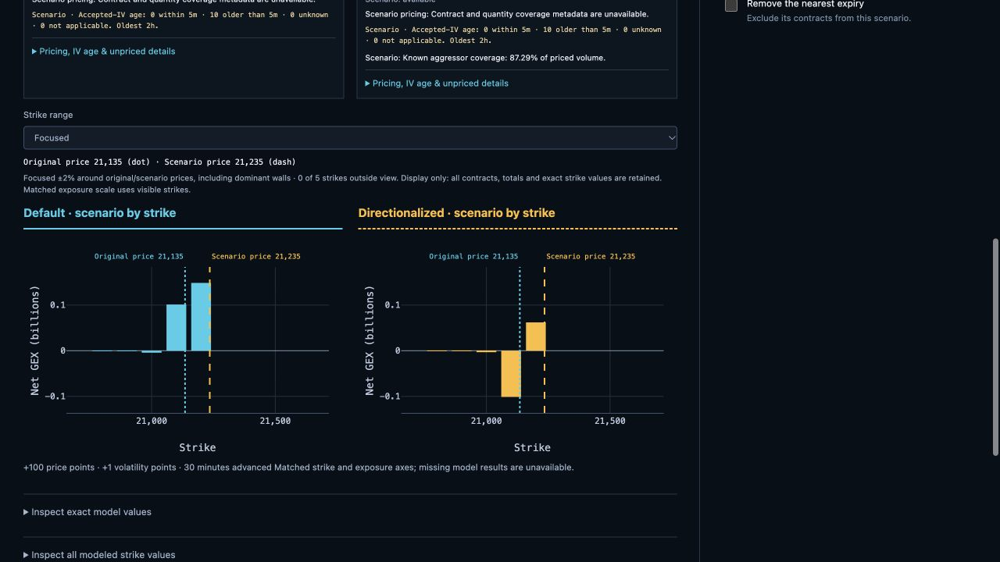

# Market Wind Tunnel

The Wind Tunnel answers a conditional research question: **if these assumptions
change, how does the modeled structure change?** It reconstructs a bundled
replay, accepts a frozen Terminal demo/replay checkpoint, or guides you through
a local captured session. It keeps the selected checkpoint's contract
quantities fixed and reprices scenarios
through the same calculation engine as the terminal.

Use [Investigate The Synthetic ES Flip](#investigate-the-synthetic-es-flip) to
compare two replay checkpoints and test the effect of one option-volume update.
[Blind Replay Study](#blind-replay-study) keeps later outcomes hidden while you
make a call for each flip, then scores the calls against **Always holds**.

The pricing notice above the charts identifies the formula and exercise-style
qualification. **Source & assumptions** explains early exercise, the configured
risk-free rate and ACT/365 timing. Newly normalized Databento futures options
with confirmed American exercise use a numerical early-exercise model. Older
captures keep their recorded model: American contracts priced with Black-76
retain the European-approximation qualification. Missing exercise metadata
remains explicitly unknown.
See [model assumptions](model-assumptions.md).



The documentation visuals use declared synthetic inputs. They illustrate the
current interface, not a live or complete ES/NQ options chain.

## Open The Workbench

In a fresh setup folder with the unified starter, open **Start GEX.command**
on macOS or run **`run-gex --choose`** on Linux, then choose **Wind Tunnel**,
**Both**, or **Saved data — Both** for an existing ES/NQ capture.
The direct **Start Wind Tunnel.command** / **run-wind-tunnel** shortcuts
also remain available, including in the original 0.6.0 setup.
[First Run](first-run.md#choose-terminal-wind-tunnel-or-both) owns the shortcut
and update details. Manual wheel installations use:

```bash
gex-terminal wind-tunnel
```

The direct command opens your browser. Keep its launcher window open; Control-C
stops the local server. In **Both**, quitting the terminal also stops the server
that combined session started. Closing a browser tab closes only the view.
The terminal and browser keep independent source selections and research state.
Ordinary **Both** opens independent synthetic sources; **Saved data — Both**
initializes both views from one private capture. Press `w` in Terminal to make
an explicit frozen handoff into a separately owned Wind Tunnel session.
No provider account, live data, CDN or telemetry is involved.
The browser connects only to a Python process on this computer. The launcher
uses a free port; the direct command defaults to port 8765. To select a free
port and an explicit research location:

```bash
gex-terminal wind-tunnel serve --port 0 --workspace ./wind_tunnel_research
```

Commands below assume `gex-terminal` is on your PATH. For the manual environment
in [First Run](first-run.md), use its explicit `gex-app/bin/gex-terminal` path
instead; no activation is required.

Add `--no-browser` to print the launch URL. Use that complete URL, including its
fragment, when reopening the app. Its random capability grants access to this
local session. Restarting creates a new capability. Saved receipts exclude it.

## Explore A Scenario

### Open Saved ES Or NQ Data In Both Views

Choose **Saved data — Both** in a fresh reviewed starter, then select ES or NQ.
The starter validates a completed normalized capture, remembers a private frozen
source and reconstructs its final checkpoint through the installed application.
[First Run](first-run.md#open-saved-es-or-nq-data) owns capture selection,
registration/reuse commands, inherited assumptions and missing-value defaults.

Wind Tunnel opens that final checkpoint. Terminal loads long sessions without
source-time delays; short samples replay at 60×. The starter prints the policy,
time span and event count. Let Terminal reach the endpoint before comparing values.
Unavailable IV and raw quantities are preserved, with excluded exposure shown
in pricing coverage. Subsequent source selections and scenarios are independent.
This path uses no provider requests or credits.

When both symbols have been registered by a current starter, use **Research
source** to switch between saved ES and NQ in the same Wind Tunnel window. Each
source has its own [timeline of net-GEX flips](#investigate-saved-session-flips).
With both captures open, you can [compare flips across saved sessions](#compare-flips-across-saved-sessions)
in one view.
The symbol selected at launch remains Terminal's input. Startup checks the
other checkpoint and its frozen capture against their registered hashes.
A missing, changed or older unbound registration is skipped with a startup
note. Register that symbol again to enable switching. The picker uses the
captures you registered.

Open **Model comparison** to review the default proxy and aggressor-directionalized proxy
side by side for the chosen ES or NQ checkpoint. Price, IV and elapsed-time
controls apply to both models from the same frozen state. The models remain
separate estimates; agreement is conditional on those inputs and does not
establish dealer identity or predictive accuracy. Unavailable IV stays excluded
and pricing coverage remains visible.

Frozen checkpoints above 500 source rows open in **Compare**. Their landscape
is calculated only when requested, using a labeled 3 × 3 preview (nine sampled
points); all contracts participate. The mesh between those points is an
interpolation. A failed landscape request leaves the valid comparison and
coverage available. Smaller sources retain the 17 × 9 landscape.

The explicit local starter accepts captures up to 1 GiB / 2 million events;
guided browser upload keeps its smaller limits. Frozen checkpoints remain
bounded to 8 MiB / 5,000 rows. Full-day final checkpoints exclude contracts that
have already expired, even though their trades remain in the capture.

### Stress A Terminal Checkpoint

In Terminal, load a demo/replay and press **`w` — Stress checkpoint**. The action
copies the consumer's current state under its lock, including spot, authoritative
market time, effective rate/DTE/multiplier, expiry filter and source quality.
Wind Tunnel opens on **Terminal selected proxy**: positive trade volume
per contract, with OI fallback, matching Terminal without summing both quantities
for one contract. Alternative volume, OI and directional models remain separate.

The browser labels this as a frozen checkpoint and shows its time, expiry filter
and captured health. It cannot scrub to other events or broaden the original
expiry filter. Later ticks, replay loads and assumption changes in Terminal do
not alter it. Press `w` again for a new checkpoint; that replaces only the handoff
service owned by this Terminal. Quitting Terminal stops that service and retains
its files. Other standalone Wind Tunnel sessions remain independent.

Checkpoint JSON and receipt workspaces are saved beneath
`wind_tunnel_handoffs/` in Terminal's working/research directory. Details (`v`)
shows the last checkpoint path. If the browser could not open, use that path in
the command below. Files contain market data; retain/share them only under the
input source's rights. A replay file is not automatically synthetic or licensed.

For an explicit CLI handoff, export a supported demo/replay checkpoint, then
open it. These commands run without live provider access:

```bash
gex-terminal --replay-session nq-research-loop --symbol NQ --multiplier 20 --wind-tunnel-checkpoint nq-checkpoint.json
gex-terminal wind-tunnel --checkpoint nq-checkpoint.json --port 0
```

To make two explicit saved files available in one source picker:

```bash
gex-terminal wind-tunnel --checkpoint es-checkpoint.json --comparison-checkpoint nq-checkpoint.json --port 0
```

`--checkpoint` sets the initial source. Repeat `--comparison-checkpoint` at most
twice; identical checkpoints appear once. All supplied files must pass the same
bounded checkpoint validation before the server starts. The browser receives
detached inputs and cannot select local paths.

Use a new output filename; an existing checkpoint is never overwritten. Input
files must be regular, bounded checkpoint JSON, not symlinks. The server reads
only the path explicitly supplied by its operator; browser requests cannot
choose filesystem paths. This is a single-state handoff, not a general session
importer or live synchronization. Live-state capture is rejected pending its
separate governed authority. Mixed legacy/v2 state, missing market time and
invalid/oversized inputs also fail closed.

### Bring A Local Captured Session

Choose **Open local session** in the workbench. Select a complete
`*.gex-session.jsonl` made by the [capture recorder](captured-sessions.md), then
review its integrity result, declared source, genuine market times, effective
model assumptions and fallback warnings. Recorded footer quality describes the
end of the original session; the opened checkpoint shows replay-computed quality
for the selected prefix. Arbitrary CSV/provider files are not
supported. Inspect your original file for sensitive content and confirm your
source permits this local use before selecting it.

Choose a capture-sequence checkpoint and explicitly open it. The production
consumer reconstructs only that prefix; later events cannot enter the frozen
input. The selection preview shows the maximum genuine message time in the
capture prefix, so a late record never moves that preview backward. The opened
checkpoint shows the consumer's authoritative accepted-state time, which can be
earlier when later captured records were ignored. A prefix without usable underlying and
option state cannot open. Missing genuine message clocks fail closed even if
the capture envelope used receipt-time fallback.

The upload is bounded to 4 MiB and 5,000 events. Up to four inspected sessions
are retained in server memory; discard an inspection before adding a fifth.
If an interrupted tab loses those inspection IDs, restart the local server to
clear its registry; saved receipts remain available.
Cancel/discard release inspected state (a pending verification is discarded when
its response arrives); server shutdown clears the registry. Raw uploads are not
written to the workspace. The browser sends bytes rather than a filesystem path;
unknown header labels and message extensions are removed after integrity
verification. Source contract identifiers become stable opaque aliases while
preserving contract linkage. Receipts still contain market data: inspect them
before sharing. Checksums establish integrity, not authenticity or
source rights. Original files remain under their owner's retention policy.

The opened source is a **Frozen captured checkpoint**. Its generated provenance
binds the complete capture content digest and selected event number. Calculation,
model comparison and save/export/reopen use the existing checkpoint workflow.
The receipt embeds its frozen input and reproduces on a fresh server without the
capture file. Reopening a receipt does not restore the full session for scrubbing;
select the original capture again to choose a different prefix. Canceling or a
failed inspection leaves the current validated research source available.

### Bundled Synthetic Sessions

1. Start with **ES Wind Tunnel Lab**, a bundled synthetic multi-expiry chain.
   Move the checkpoint to select the last replay event permitted into the model.
2. Choose a position model. Volume, open interest and aggressor-directionalized
   volume are separate proxies; the workbench never sums them.
3. Change spot, IV or elapsed time, or remove the nearest expiry. Inspect the
   original and scenario metrics and contract contributions.
4. Switch between **Exposure landscape**, **Compare** and **Fragility map**.
   Save a useful scenario and reopen it from **Saved scenarios**.

The landscape prices a spot/time grid with the selected IV and expiry settings.
Each plotted value comes from a calculation. A 2D view and inspectable tables
keep results accessible where WebGL is unavailable. Compare uses matched axes
so a larger-looking plot cannot come from a different scale. Fragility shows
only tested cells: missing or invalid cells do not mean stability.

## Investigate The Synthetic ES Flip

1. Choose **Zero-Gamma Flip** in the source picker, then select **Investigate
   net-GEX flip**. The investigation compares 16:00:00 and 16:00:04 UTC on
   July 16, 2026 in the bundled ES replay using the volume proxy.
2. Compare the two checkpoints and inspect the contract contributions. The
   futures price is 5,948.75 at both cutoffs. The 5,950 call's 2,880-contract
   volume update drives the modeled net GEX from negative to positive and the
   dominant wall from 5,925 to 5,950.
3. Select **Remove call-volume update**. The workbench recomputes the later
   cutoff without that update. Net GEX stays negative and the wall stays at
   5,925 in this calculation.
4. Choose **Save investigation**. In **Saved scenarios**, use **Reopen** to
   reproduce the investigation or **Export JSON** to retain a portable receipt.
   Apply the [verification and reproduction commands](#save-export-and-reproduce)
   to the exported file.

The investigation uses a fixed pair of checkpoints in the bundled synthetic ES
replay. The legacy fixture groups option rows by strike and side, with a
synthetic 0DTE label and a 0.01-day pricing fallback. Its contributions explain
the change in the model calculation for these replay inputs.

## Investigate Saved Session Flips

Open **Saved data — Both** from a current setup and choose **ES** or **NQ**.
To start Wind Tunnel directly with both markets, pass both completed normalized
captures. The window starts on ES and lets you switch to NQ in **Research
source**. Pass just one capture flag to open a single market.

```bash
gex-terminal wind-tunnel serve \
  --saved-es-capture /path/to/es.gex-session.jsonl \
  --saved-nq-capture /path/to/nq.gex-session.jsonl
```

1. Select **Find net-GEX flips** on the saved replay timeline. Small
   captures are checked at each accepted update. On larger or more expensive
   captures, Wind Tunnel samples the session and narrows detected opposing-sign
   brackets to an exact driving update. Brief flips between samples can be
   missed. A flip requires priced exposure with opposing, nonzero signs.
2. Select a timeline marker to inspect the two states and the change in priced
   exposure by contract. Capture sequence orders updates with identical
   timestamps. The timeline uses the Terminal selected proxy and the capture's
   pricing assumptions. Missing IV remains visible as a pricing coverage gap.
3. Select **Remove driving update** to omit the selected event at the same cutoff.
   An underlying tick can reprice many contracts at once. The counterfactual
   shows whether the modeled sign change survives and reports unavailable
   exposure when the remaining inputs cannot price it.
4. Select **Save investigation**. **Saved scenarios** shows receipts from both
   open markets. Reopening an investigation verifies the receipt against its
   capture and selects that source. To reproduce an exported receipt from the
   CLI, pass the original capture and use a compatible calculation build. Match
   the flag to the receipt's market.

   ```bash
   gex-terminal wind-tunnel reproduce /path/to/receipt.json --saved-nq-capture /path/to/nq.gex-session.jsonl
   ```



*A saved synthetic ES capture in Wind Tunnel. The timeline selects the driving
event and the comparison shows its exposure change.*

The receipt binds the capture checksum, event sequence, model and calculated
results. It references the original capture, and its contract details still
contain market data. Keep the capture and receipt according to your data rights.
When both captures are open, choose the capture in **Research source** before
starting an investigation. Each timeline, contribution table, removed update
and receipt belongs to the capture that supplied the flip. Scenario controls
continue to operate on the selected frozen checkpoint.

## Review A Saved Flip Blind

Open a dedicated window with one completed capture. Use
`--saved-es-capture` for ES or `--saved-nq-capture` for NQ.

```bash
gex-terminal wind-tunnel serve --blind-review --saved-nq-capture /path/to/nq.gex-session.jsonl
```

To switch between ES and NQ in the same window, supply one completed capture
per market. ES opens first. Use **Saved session** to switch markets. Switching
preserves each capture's draft, committed read, reveal result and save progress.

```bash
gex-terminal wind-tunnel serve --blind-review \
  --saved-es-capture /path/to/es.gex-session.jsonl \
  --saved-nq-capture /path/to/nq.gex-session.jsonl
```

Wind Tunnel stops at the first eligible modeled flip in each capture. Add
`--flip-sequence N` to select an exact event sequence for the initial capture.
That sequence applies to ES when both markets are open and to Session A for a
pair from the same market. Each review starts with the selected flip, its
contract drivers and its update-removal result. The ordinary final checkpoint,
full-session timeline and scenario views stay outside this window.

1. Enter **Your read**, then select **Commit read and reveal**. The read locks
   before Wind Tunnel calculates the outcome.
2. Review the **30-minute outcome** and **Futures price path**. The net-GEX sign
   uses the accepted state through the target, valued at that time. The price
   path shows observations for the same futures identity, with the observation
   gaps and ages visible. If the capture ends early or the evidence is
   insufficient, the sign is unavailable and any observed path remains visible.
3. Choose **Save review**. The receipt binds the capture checksum, event
   sequence, committed read, and later result for one capture. **Saved reviews**
   lists receipts for the selected capture. **Reopen** verifies a receipt for
   that capture and restores its committed read and outcome.

Blind review saves in `wind_tunnel_reviews` by default. Use `--workspace PATH`
to choose another local receipt workspace. To reproduce an exported review,
use a compatible calculation build and supply only the original capture with
its matching market flag. The receipt identifies the event sequence.

```bash
gex-terminal wind-tunnel reproduce /path/to/review.json \
  --saved-nq-capture /path/to/nq.gex-session.jsonl
```

### Compare Two Blind Reviews

For a mixed ES and NQ pair, use the two-market launch command above and select
**Compare ES and NQ**. For two distinct captures from the same market, repeat
that market's capture flag and select **Compare saved sessions**. The first
capture opens as **Session A** and the second as **Session B**. Use
**Review one session** to return to an individual capture.

```bash
gex-terminal wind-tunnel serve --blind-review \
  --saved-es-capture /path/to/es-first.gex-session.jsonl \
  --saved-es-capture /path/to/es-second.gex-session.jsonl
```

1. Inspect each capture's flip, contract drivers and update-removal result in
   its own panel. Enter **Your read** and select **Commit read and reveal** in
   each panel when ready. Each commitment reveals only that capture's 30-minute
   net-GEX sign and futures price path.
2. After both outcomes are visible, choose **Save comparison**. The paired
   receipt records each capture checksum, flip sequence, committed read and
   revealed outcome.
3. In **Saved comparisons**, choose **Reopen** to verify and restore both
   reviews, or **Export JSON** to keep the paired receipt. To reproduce it from
   the command line, use a compatible calculation build and supply both
   original captures with their market flags. Wind Tunnel matches the files by
   checksum, so either flag order works.

   ```bash
   gex-terminal wind-tunnel reproduce /path/to/comparison.json \
     --saved-es-capture /path/to/es.gex-session.jsonl \
     --saved-nq-capture /path/to/nq.gex-session.jsonl

   gex-terminal wind-tunnel reproduce /path/to/es-comparison.json \
     --saved-es-capture /path/to/es-first.gex-session.jsonl \
     --saved-es-capture /path/to/es-second.gex-session.jsonl
   ```



*Blind Replay Review can reveal the outcome for Session A while Session B is
still waiting for its read.*

## Blind Replay Study

Blind Replay Study uses one case per capture. For a saved session, Wind Tunnel
selects the first eligible net-GEX flip. The case shows the starting flip,
contract drivers and update-removal result at that cutoff. The outcome and
price path stay hidden until you lock the study's complete set of calls. Use
Blind Replay Review to record a read for a single flip.

| To | Open with `gex-terminal wind-tunnel serve --blind-study` and |
| --- | --- |
| [Try the built-in synthetic ES study](#run-the-synthetic-es-blind-replay-study) | No capture flags |
| [Study saved ES](#run-a-saved-es-blind-replay-study) or [saved NQ](#run-a-saved-nq-blind-replay-study) | Repeated `--saved-es-capture` or `--saved-nq-capture` flags for one market |
| [Switch or compare ES and NQ](#switch-between-saved-es-and-nq-studies) | Both market flags |
| [Compare two saved studies](#compare-two-saved-studies) | `--study-a-capture` and `--study-b-capture` for separate capture sets from the same or different markets |

### Run The Synthetic ES Blind Replay Study

Open a separate study window with the built-in synthetic ES cases.

```bash
gex-terminal wind-tunnel serve --blind-study
```

1. Open each case and choose **Sign holds** or **Sign changes** for the modeled
   net-GEX sign 30 minutes after the flip. Add an optional note. A session with
   no eligible flip needs no call.
2. Select **Lock calls and reveal** after completing every eligible case. All
   calls lock together. **Sign holds** means the sign at the horizon matches
   the sign just after the flip. **Sign changes** includes zero at the horizon.
3. Compare your score with **Always holds**, which makes the **Sign holds**
   call for every scored case. Both scores use the same denominator. Cases
   without a flip or usable 30-minute sign remain visible with an exclusion
   reason. A capture can end early, switch futures contracts or lack usable
   exposure at the horizon. Select **Inspect miss** to see the committed call,
   contract contributions, driving-update removal and observed price path.
4. Choose **Save study** to keep one receipt for the locked calls, capture
   identities, outcomes, and scores. **Saved studies → Reopen** recomputes the
   study and restores the verified result.



*Before submission, the synthetic ES study shows the case queue and the
starting evidence. Its scorecard and later outcomes appear after the calls lock.*

The default receipt workspace is `wind_tunnel_studies`. Use `--workspace PATH`
to select another workspace. You can export the receipt and reproduce it in a
fresh process using the built-in synthetic captures.

```bash
gex-terminal wind-tunnel reproduce /path/to/study-receipt.json
```

The score measures decisions on this synthetic study of modeled sign
persistence. Predictive validity remains unmeasured.

### Run A Saved ES Blind Replay Study

Choose one to eight distinct, completed normalized ES captures. Repeat the
capture flag for every file you want in the study.

```bash
gex-terminal wind-tunnel serve --blind-study \
  --saved-es-capture /path/to/es-monday.gex-session.jsonl \
  --saved-es-capture /path/to/es-tuesday.gex-session.jsonl
```

Wind Tunnel selects the first eligible flip in each capture and fixes the case
order for that study. The case list identifies each capture by its checksum and
shows the cutoff when it has a flip. Submit the full set of calls to reveal the
30-minute outcomes. Your score and **Always holds** use the same cases with
available signs. Sessions without a flip and cases with unavailable outcomes
remain visible in the results. **Inspect miss** opens the drivers, the
driving-update removal result, and the observed price path for that case.

**Save study** creates one receipt. Open the same set of captures with the
same workspace to use **Saved studies → Reopen**. A reopened study restores
the receipt's case order. To verify an exported receipt in a fresh process,
supply the same original files in any order. Wind Tunnel matches them by checksum.

```bash
gex-terminal wind-tunnel reproduce /path/to/saved-es-study.json \
  --saved-es-capture /path/to/es-monday.gex-session.jsonl \
  --saved-es-capture /path/to/es-tuesday.gex-session.jsonl
```

The score describes modeled sign persistence on the selected captures.
Predictive validity remains unmeasured.

### Run A Saved NQ Blind Replay Study

Choose one to eight distinct, completed normalized NQ captures with repeated
`--saved-nq-capture` flags.

```bash
gex-terminal wind-tunnel serve --blind-study \
  --saved-nq-capture /path/to/nq-monday.gex-session.jsonl \
  --saved-nq-capture /path/to/nq-tuesday.gex-session.jsonl
```

The study selects the first eligible flip in each capture. Complete all calls
before revealing outcomes, compare your score with **Always holds**, and use
**Inspect miss** to review contract contributions, driving-update removal, and
the observed NQ price path. **Save study** creates one receipt for the group.

Launch with the same original captures and workspace to reopen the receipt
from **Saved studies**. Both reopening and CLI reproduction match capture
checksums and restore the recorded case order.

```bash
gex-terminal wind-tunnel reproduce /path/to/saved-nq-study.json \
  --saved-nq-capture /path/to/nq-monday.gex-session.jsonl \
  --saved-nq-capture /path/to/nq-tuesday.gex-session.jsonl
```

### Switch Between Saved ES And NQ Studies

Launch with both kinds of capture flags to open two independent studies in
one window. Supply one to eight distinct completed captures per market.

```bash
gex-terminal wind-tunnel serve --blind-study \
  --saved-es-capture /path/to/es-monday.gex-session.jsonl \
  --saved-es-capture /path/to/es-tuesday.gex-session.jsonl \
  --saved-nq-capture /path/to/nq-monday.gex-session.jsonl \
  --saved-nq-capture /path/to/nq-tuesday.gex-session.jsonl
```

ES opens first. Choose **ES** or **NQ** under **Saved market** to switch.
Each study preserves its own draft calls and notes, locked calls, revealed
outcomes, and baseline score. **Save study** and **Saved studies** apply to the
selected market and its exact capture set. To reopen a receipt, select its
market with the same set of captures and workspace. For CLI reproduction, pass
only the original captures named by that receipt using the matching market flag.
The [ES example](#run-a-saved-es-blind-replay-study) and
[NQ example](#run-a-saved-nq-blind-replay-study) show the individual commands.

#### Compare Saved ES And NQ Studies

Launch with both sets of captures as above, then select **Compare ES and NQ**.
Use **Review one study** to return to the market picker. The same drafts and
submitted calls are available in both views.

1. Complete the calls in each panel. **Lock calls and reveal** opens that
   study's 30-minute outcomes after its entire set of calls is submitted.
2. Read each scorecard against its own **Always holds** baseline. Select
   **Inspect miss** to see that case's contract drivers, driving-update removal,
   and observed futures price path in its market's panel.
3. Once both scorecards are available, select **Save comparison**. Open
   **Saved comparisons → Reopen** to verify and restore both studies together.
   **Export JSON** keeps the comparison in one file.

Use both original capture sets and the same workspace when reopening. To
reproduce an export in a fresh process, pass every original ES and NQ capture:

```bash
gex-terminal wind-tunnel reproduce /path/to/study-comparison.json \
  --saved-es-capture /path/to/es-monday.gex-session.jsonl \
  --saved-es-capture /path/to/es-tuesday.gex-session.jsonl \
  --saved-nq-capture /path/to/nq-monday.gex-session.jsonl \
  --saved-nq-capture /path/to/nq-tuesday.gex-session.jsonl
```

Wind Tunnel matches capture checksums and restores each study's original case
order. The two scorecards retain their own scored-case counts and exclusions.

### Compare Two Saved Studies

Use **Study A** and **Study B** to compare two sets of captures directly. Each
study takes one to eight distinct, completed normalized captures from a single
market. Use separate captures for each study to keep both reveal gates meaningful.
Wind Tunnel reads the market from the capture, so both sides can be ES, both can
be NQ, or the markets can differ.

```bash
gex-terminal wind-tunnel serve --blind-study \
  --study-a-capture /path/to/es-monday.gex-session.jsonl \
  --study-a-capture /path/to/es-tuesday.gex-session.jsonl \
  --study-b-capture /path/to/es-wednesday.gex-session.jsonl
```

Call each eligible flip in a study, then select **Lock calls and reveal** in
its panel. Each scorecard shows your accuracy, the **Always holds** baseline,
and coverage for that study. Select **Inspect miss** for the case's contract
drivers, the driving-update removal result, and the observed 30-minute price
path.



*Scorecards and selected misses for two studies built from synthetic ES captures.*

Once both studies reveal, select **Save comparison**. Launch with the same
workspace and each study's original captures, then use **Saved comparisons →
Reopen** to verify and restore both studies. Use **Export JSON** for a portable
receipt. Supply each original capture to the same side to reproduce the export
in a fresh process. Wind Tunnel matches the checksums and restores the recorded
case order within each study.

```bash
gex-terminal wind-tunnel reproduce /path/to/study-comparison.json \
  --study-a-capture /path/to/es-tuesday.gex-session.jsonl \
  --study-a-capture /path/to/es-monday.gex-session.jsonl \
  --study-b-capture /path/to/es-wednesday.gex-session.jsonl
```

## Compare Flips Across Saved Sessions

Open two distinct saved captures in the same Wind Tunnel window. The starter
remembers one capture per symbol and can open the registered ES and NQ pair.
To open two captures of the same market, repeat that market's capture flag in a
direct launch. Use `--saved-es-capture` for ES and `--saved-nq-capture` for NQ.

```bash
gex-terminal wind-tunnel serve \
  --saved-es-capture /path/to/es-first.gex-session.jsonl \
  --saved-es-capture /path/to/es-second.gex-session.jsonl
```

1. Select **Compare saved flips**. Wind Tunnel uses available timeline markers
   and scans a capture if its markers have yet to load.
2. Choose a capture for **Session A** and another for **Session B**. Use the
   capture time and short checksum to tell captures of the same market apart.
   Choose each session's flip by timestamp, sign change and event sequence, then
   select **Compare flips** to view the pair.
3. Review the before and after exposure, contract contributions and removal
   result in each panel. Wind Tunnel omits each driving update independently at
   its own event cutoff. Each side retains its capture's model inputs and
   pricing coverage.
4. Select **Save comparison** to keep the pair in one receipt. Use **Saved
   scenarios → Reopen** to reproduce both sides and restore the selections, or
   use **Export JSON** to reproduce the receipt from the CLI.

The comparison saves to the current window's primary receipt workspace. With
both workspaces open through the starter, **Saved scenarios** lists the
comparison when you launch from either market.

The comparison receipt records both capture checksums and event sequences. Keep
both original captures with the receipt to reproduce the paired calculation on
a compatible build. The CLI matches the files by checksum regardless of the
order of the capture flags. The receipt contains calculated contract details
from both captures.

```bash
gex-terminal wind-tunnel reproduce /path/to/comparison.json \
  --saved-es-capture /path/to/es-first.gex-session.jsonl \
  --saved-es-capture /path/to/es-second.gex-session.jsonl
```

## Compare Default And Directionalized Models

Choose **Model comparison** to view both quantity proxies side by side. Each
column shows its original and recalculated net GEX, dominant wall, pricing
coverage and unpriced-contract details. The strike charts use matched axes;
the exact-values table distinguishes unavailable output from zero.



The default is **Terminal selected proxy** for a frozen checkpoint and
**Volume proxy** for a bundled replay. The directionalized model uses signed
aggressor-side volume under an assumed passive-counterparty position. The two
models can use different quantity cohorts. Neither observes actual dealer
inventory or whether a trade opens or closes a position; never add them.

Price, IV and time controls apply to both columns. Presets reset the other
shocks to zero so you can inspect one change at a time. **Run 54-case grid** is
an explicit, separate calculation from the original checkpoint: price
−25/0/+25 points for ES or −100/0/+100 for NQ, IV −1/0/+1 volatility point, and
time 0/30/60 minutes, with nearest-expiry exclusion off. Its 27 coordinates per
model include combined shocks. A large saved checkpoint is a batch calculation;
calculations remain local and bounded. The workbench reuses identical
pricing work within a request without changing either model's selected quantities.

Grid summaries count positive, negative, zero and unavailable results and show
the tested exposure range and dominant walls. Missing cases do not establish
stability. Changing the source or scenario clears the current results and grid
conclusions. The grid does not ingest later events, fill unavailable IV, or
estimate future prices or probabilities. Time beyond the capture is model time.

Save a model comparison with **Save scenario**. Its receipt includes the
original input, both models, exact controls and the grid when requested.
The browser receives a smaller display response without repeated contract
contributions or an echoed checkpoint. Saving recalculates a full receipt from
the original input; exported receipts retain the source and contribution details.
Reopening verifies it against the same calculation build and runtime. Old
receipts retain their original implementation identity and need their original
build for exact reproduction.

[Model comparison](model-comparison.md) explains how to interpret model
agreement, directional coverage and the separate CLI report harness.

### Locate Price And Choose A Strike Range

**Compare** and **Model comparison** mark the original and scenario futures
prices on their strike charts. A dotted cyan line marks the original price and
a dashed gold line marks the scenario price. If the prices match, one solid
line marks both; missing prices do not produce a fabricated marker.

**Strike range — Focused** starts around the two prices with a ±2% envelope,
expands to include the displayed dominant walls, and adds chart padding.
**Full range** restores all modeled strikes. Both charts use matched strike
and exposure axes within the chosen range. The note reports how many strikes
are outside the view. This is a display setting: quantities, pricing selection,
GEX totals and grid results do not change. **Inspect all modeled strike values**
in Model comparison includes the strikes outside the chart view.



## Read Pricing Coverage

The **Pricing coverage** panel above the charts shows priced/selected contracts
and priced/selected quantity, with percentages. Read **Original** and
**Scenario** separately; identical coverage shares an **Original & scenario**
panel. The denominators follow the selected quantity model and eligible expiry
cohorts, not incoming event counts. Earlier valid IVs count as priced and are
separately labeled.

**Complete** covers every selected contract and quantity. **Partial** excludes
unpriced exposure from GEX while retaining its raw quantity, and never rounds
up to 100%. **Unavailable — no selected contracts are priced** means GEX is
unavailable rather than zero. **No selected contracts** means the current
selection is empty, with coverage percentages not applicable. **Coverage
unavailable** means contract-level coverage cannot be established; a legacy
aggregate must not be read as complete coverage.

Open **Source & assumptions** for each unpriced contract and its captured
pricing inputs. Available evidence includes the original premium, violated
model bound, underlying input and quote age. These describe the failed
inversion at capture time, even after spot, IV or time changes. Scenario controls
do not fill unavailable IV or rewrite that evidence. A mismatch explains the
model failure without establishing its market or feed cause.
[Model Assumptions](model-assumptions.md#quantity-and-position-sources) owns the
pricing and retention policy.

## Read Source Health And Accepted-IV Age

The header shows **Mode** and **Health** separately. **REPLAY** describes how
the saved source runs; **degraded** describes its captured source ledger.
That health can include earlier or expired contract events, so it is separate
from the active pricing-coverage denominator. Freezing or replaying a source
does not repair its recorded health.

**Accepted-IV age** appears in pricing coverage, each model card and
**Source & assumptions**. It counts priced contracts within five minutes,
older than five minutes, unknown, or not applicable, and shows the oldest
measurable observation and affected selected quantities. Unpriced contracts
remain outside this age distribution. Configured or unspecified IV is not
presented as an observed fresh quote.

Coverage and age headlines stay visible. Expand **Pricing, IV age & unpriced
details** for the observation clocks, quantity breakdown, timing uncertainty
and captured unpriced-contract inputs.

Original ages use the **Captured cutoff**; scenario ages use the displayed
**Scenario model time**. Time changes add elapsed model time to the same
accepted observations without reading later data. Retained prior-valid IV uses
its original accepted observation time, not the subsequent failed-inversion
tick. Missing provenance, invalid/future clocks or ambiguity in the saved
capture timestamp's precision can leave age unknown.

Five minutes is an age reference, not an IV validity filter. An unchanged
accepted IV can be hours old and still count as priced. The separate 300-second
rule for retaining IV after a new failed inversion remains unchanged. Freshness,
pricing coverage and source health answer different questions; none establishes
a synchronized complete option chain.

## What The Controls Mean

| Control | Meaning |
| --- | --- |
| Spot shift | Add underlying price points to the checkpoint spot; not a percentage return |
| IV shift | Add absolute volatility points uniformly to each row; +1 means +0.01 annualized IV |
| Time advance | Advance model time in minutes with quantities frozen; later replay events are not consumed |
| Remove nearest expiry | Remove the expiry cohort nearest at the original checkpoint, even after time advances; never retarget a later cohort |
| Position model | Select an independent quantity proxy on the same frozen input |

`Terminal selected proxy` is available only for Terminal checkpoints. It
preserves their explicit per-contract fallback policy; it is not an additional
source of quantities to sum with the other models.

The IV policy is sticky strike with a uniform shift, not a simulated volatility
smile. Invalid nonpositive spot or IV, expired contracts and absent quantities
are handled explicitly. Exact expiry instants take precedence; legacy rows use
the declared fallback time to expiry. Changing time does not invent trades,
open-interest updates, hedging activity or a future price path.

The API rejects unknown fields, nonfinite numbers, ambiguous models and
out-of-range requests. Absolute supported limits are spot shift ±5,000 points,
IV shift ±100 volatility points and time advance 0–43,200 minutes. Each grid
axis accepts at most 41 distinct increasing values, at most 1,681 cells. Browser
controls offer narrower practical ranges. These limits bound computation;
they do not imply that extreme scenarios are plausible.

## Find A Breaking Case

Choose a dominant-wall change, net-GEX sign change or model disagreement and
run a bounded search. A model disagreement means the two selected models differ
in their dominant wall or net sign at the same sampled point. It is a sensitivity
finding, not evidence that one model is correct.

Wall/sign searches compare candidates with the zero-shock checkpoint (time zero,
no expiry exclusion). Fixed time or expiry changes apply only to candidates, so
a changed claim can occur at a zero/zero grid coordinate. Grid values replace
the common shocks on their selected axes; they are not added to those shocks.

The nearest result minimizes
`sqrt((x / x_scale)^2 + (y / y_scale)^2)` among changed sampled points. Each
scale is the largest absolute tested coordinate on that axis; a zero-only axis
uses one. Ties resolve by distance, then ascending x and y. Fixed shocks such as
time advance or expiry removal are disclosed and excluded from this two-axis
distance. Changing bounds or grid resolution can change the nearest result.

- **Break found:** at least one tested point changes the selected claim.
- **No break found:** no evaluable tested point changes it within this grid.
- **Not evaluable:** required exposure, contracts or directional coverage are
  unavailable. Unavailable cells cannot support a no-break conclusion.

The result is a nearest **tested** change, never a global minimum, probability
or safety guarantee. A wall is the model's dominant exposure strike; no observed
dealer positioning, support/resistance certainty or prediction is inferred.

## Save, Export And Reproduce

Saving recalculates the submitted inputs on the server, then writes an immutable
receipt containing the normalized request, bundled source/checkpoint identity,
calculation fingerprint, results and checksum. Terminal handoff requests also
embed their frozen input, so reproduction does not need the original checkpoint
file or running Terminal. Open a saved scenario to
recalculate it; export its JSON to retain or transfer it. Receipt verification
checks content integrity and independently recomputes the result.

```bash
gex-terminal wind-tunnel verify experiment.json
gex-terminal wind-tunnel reproduce experiment.json --output reproduction.json
```

[Saved-session flip receipts](#investigate-saved-session-flips) and
[blind review receipts](#review-a-saved-flip-blind) use the original capture
files for reproduction. [Paired flip comparisons](#compare-flips-across-saved-sessions)
and [paired blind reviews](#compare-two-blind-reviews) require both captures.
[Synthetic ES study receipts](#run-the-synthetic-es-blind-replay-study) use the
built-in study captures and reproduce without capture flags.
[Saved ES study receipts](#run-a-saved-es-blind-replay-study) and
[saved NQ study receipts](#run-a-saved-nq-blind-replay-study) require every
original capture with the matching market flag.
[Study A/B receipts](#compare-two-saved-studies) require the original capture
sets for the two sides. Receipts from [the ES/NQ study switcher](#compare-saved-es-and-nq-studies)
use the ES and NQ capture flags.

Files are never overwritten. Choose a new output filename. Exact reproduction
requires the same supported schema, source, implementation, application version,
Python minor and NumPy version. A changed build can yield a mismatch even if its
displayed rounded values look alike. A checksum proves content identity, not
the truth or authorship of a research claim.

Checkpoint inputs are limited to 8 MiB and 5,000 copied rows. Requests and saved
receipts obey a 32 MiB JSON bound so full-session checkpoints and their detailed
results can be retained together. Browser capture intake keeps its separate
4 MiB / 5,000-event bound. No data is silently truncated.
The workspace must be empty or already owned by the Wind Tunnel. It holds up to
100 receipts, 32 MiB per receipt and 64 MiB total. Keep unrelated files elsewhere.
When full, choose a new workspace and preserve the old one. Browser requests
cannot select arbitrary disk paths. Existing terminal research remains separate.

API clients must forward signed receipt JSON text unchanged. Parsing and
reserializing it in another language can change number formatting and invalidate
the checksum. The browser preserves the original text for reopen/import and
exports the exact server response bytes.

## Three Completed Examples

The **Examples** control runs these requests against the installed calculation
engine. It also opens the [synthetic ES flip investigation](#investigate-the-synthetic-es-flip)
in the browser. Use these commands to reproduce the three scenario examples
from a manual installation.

```bash
gex-terminal wind-tunnel example discovered-break --output discovered-break.json
gex-terminal wind-tunnel verify discovered-break.json
gex-terminal wind-tunnel example no-break --output no-break.json
gex-terminal wind-tunnel verify no-break.json
gex-terminal wind-tunnel example expiry-exclusion --output expiry-exclusion.json
gex-terminal wind-tunnel verify expiry-exclusion.json
```

| Example | What it demonstrates |
| --- | --- |
| `discovered-break` | A broad synthetic spot/IV grid changes the original dominant wall and identifies the nearest tested changed point |
| `no-break` | A narrow synthetic neighborhood retains its dominant wall at all tested points; the conclusion stays inside those bounds |
| `expiry-exclusion` | Removing the front expiry changes the composition of a multi-expiry synthetic chain while preserving the remaining contracts |

Verification coverage and release identity are recorded in
[GEX-WIND-001](work-packets/GEX-WIND-001.md). The examples verify the software
workflow only. `predictive_validity` remains `unmeasured`; dealer/customer and
opening/closing classifications remain `unobserved`.

## Assets And Recovery

The wheel bundles Plotly.js 4.1.1 and a selected set of Phosphor 2.1.1 icons.
Their MIT license notices and exact file identities are retained in
`gex_terminal/wind_tunnel_web/vendor/`. No browser build step is needed.

Install updates into a fresh reviewed setup folder, retain the previous folder
and your receipts, and use the previous launcher to roll back. Receipt
reproduction reports disagreement instead of silently rewriting old results.
The September 20 frozen study remains a separately identified historical build.
